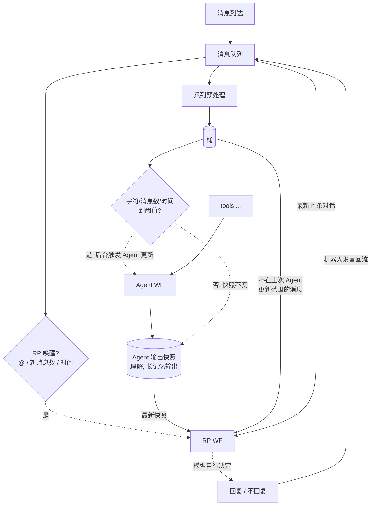

# 多 workflow 编排会话 (flow)

issue #4 "Edictum 范式增加与自定义编辑"。新增 `flow` 会话类型: 多个 workflow 由节点图编排, 配可视化编辑器。

## 文档

| 文件 | 内容 | 读者 |
| --- | --- | --- |
| [runtime-contract.md](runtime-contract.md) | 执行语义: 条件三值, 共享求值, 阈值位置, 预算, 状态槽 CAS, 失败处理, 重启 | 实现宿主, 写插件节点 |
| [node-contract.md](node-contract.md) | 插件节点契约: `meta.yaml` + `flow_nodes.py` 写法, 存档格式, 迁移, 安装时拒绝的写法 | 写插件节点, 实现契约解析 |
| [frontend-plan.md](frontend-plan.md) | 前端实现计划: 后端前置小改, 流程编辑器, 插件节点默认, 运行状态面板, 测试 | 前端实现 agent 从这里开始 |

前端历史原型在 `satrap-ui-preview/src/flow/` (被 `.gitignore` 忽略, 不入库): `registry.ts` 内置节点和端口, `validate.ts` 静态检查规则, `Simulator.tsx` 运行语义参考, `model.ts` 存档格式和模板。原型仅作历史参考, 现行后端行为以运行时契约、插件节点契约和实际实现为准。

## 验收用例

范式和编辑器至少要能完整表达并运行这张群聊会话图:

已确认的语义:

1. Agent 在后台运行。RP 被唤醒时不等 Agent, 直接使用当前最新快照
2. 机器人自己的发言进入桶, Agent 能看到
3. Agent 只写快照。只有显式给 Agent 装上 memory 插件时才写长期记忆; 写快照和写记忆是两个不同的插件
4. 作用范围是单个会话 (一个群, 或一个私聊对象), 各有一份桶, 阈值位置和快照
5. RP 按条件唤醒 (@, 新消息数, 时间等), 唤醒后由 RP 模型自己决定回不回复
6. Agent 的触发条件同样支持消息数, 字符数和时间

## 和现有机制的对应

| 图中元素 | 现有机制 | 在 flow 里怎么用 |
| --- | --- | --- |
| 消息队列 / 桶 | `PlatformMessageStore` 消息档案 (`satrap/core/config/platform_messages.py`), 入站和已确认出站消息都入档 | 桶建在档案上, 天然包含机器人发言 |
| RP 唤醒 | `wake_policy.evaluate_wake` (`satrap/core/pipeline/wake_policy.py`) | 群唤醒磁贴勾选"沿用群策略"时复用 |
| 唤醒窗口 `WakeWindow` | 短期, 被消费掉的缓冲 (120 秒, 32 条) | 不用作桶; 桶需要持久, 有序, 不被消费 |
| 回复 | `ReplyTurn` (`satrap/core/group_chat/reply.py`), 后台发送合约 (`satrap/core/platform/scheduled.py`) | 平台回复节点自带 `flow_reply` 工具, 宿主按有无来源消息选择发送路径; 不依赖 group_chat 插件 |
| 长期记忆 | memory 插件 | 只装在需要写记忆的 WF 上 |
