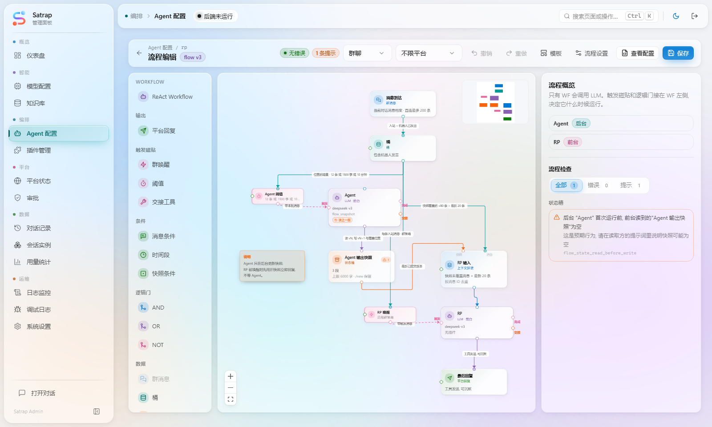
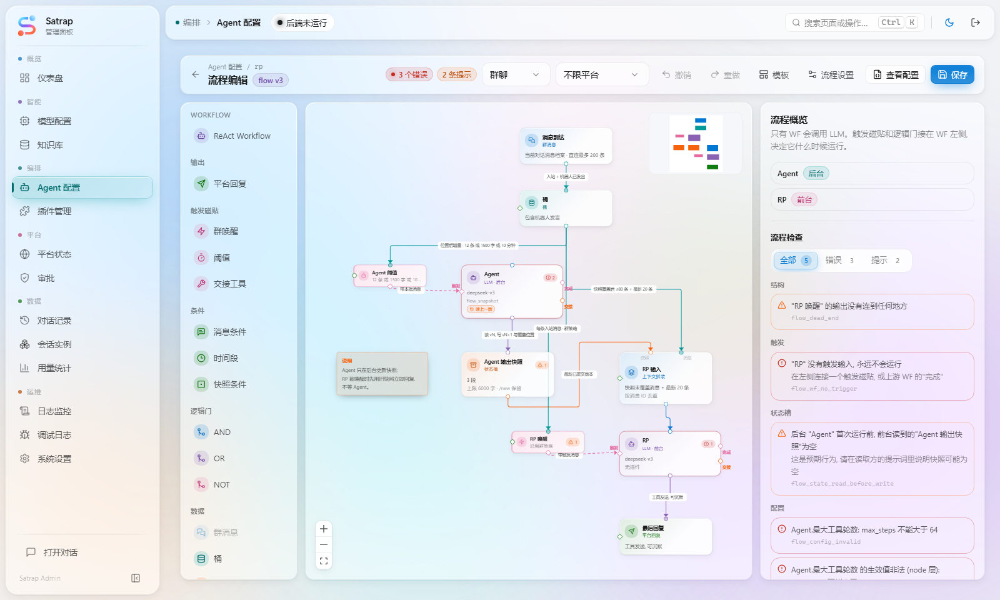

# 流程会话

流程会话 (`flow` 类型) 用一张节点图把多个 WF 组织在一起。常见用法是: 群消息先进入消息桶, 消息攒够后由后台 Agent 更新一份群理解快照; 有人唤醒时, 前台 RP 读取快照、快照之后的新消息和最近几条消息, 再决定是否回复。

## 新建流程

1. 打开 **Agent 配置**, 切到 **Edictum 流程**, 点类型列表里的 `flow`。
2. 在抽屉里填写配置名称和描述, 点 **下一步: 编辑流程**。
3. 进入编辑器后选择一个模板, 或从空白画布开始。
4. 点 **创建**。第一次保存时才会生成命名配置, 中途离开不会留下空配置。

已有的流程配置, 在编辑抽屉里点 **打开流程编辑器** 进入。流程会话不使用顶层插件和 JSON 参数, 这两项在抽屉里不显示。

## 节点与连线

- 左侧节点面板按用途分组。插件提供的节点单独列在 **插件节点** 下。有数量上限的节点放满后会置灰。
- 拖动节点到画布, 或点击节点名添加到画布中央。
- 从输出端口拖到输入端口建立连线。端口颜色表示数据类型, 菱形端口是触发、条件和交接这类信号端口。拖线时只有类型相符的端口会高亮, 类型不符的连线放不下。
- 只能接一条线的输入端口, 新连线会替换原来那条。
- 连线上的文字是读取说明, 由接收节点的配置决定, 随配置自动更新。双击连线可以写一条注释, 注释随流程保存, 不影响运行。
- `Ctrl` + `Z` 撤销, `Ctrl` + `Shift` + `Z` 或 `Ctrl` + `Y` 重做, 最多 50 步。

## 节点配置

点击节点后, 右侧检查器显示它的配置。每个字段旁标注值的来源:

| 来源 | 含义 |
| --- | --- |
| 类型默认 | 节点类型自带的默认值 |
| 插件全局 | 插件管理页里设置的节点默认, 对所有流程生效 |
| 流程默认 | 本流程里同类节点共用的值 |
| 本节点 | 只对这个节点生效 |

后面的层覆盖前面的层。本节点改过的字段可以点 **恢复继承**, 也可以点 **设为流程默认**, 让同一流程里其他同类节点也使用这个值。

WF 节点的插件在 **插件** 一栏勾选, 插件只装在这个 WF 上。标注"仅前台"的插件不能装在只由阈值触发的后台 WF 上。

**流程设置** 里可以查看和移除流程默认, 也可以开启硬预算: 统计窗口内的模型调用达到上限后, 后续触发会被拦截。

## 检查与保存

编辑后编辑器会自动请后端检查流程。顶部显示错误和提示的数量, 不选中任何节点时右侧显示完整的问题列表, 按分类分组。点一条问题会定位到相关节点或连线, 有具体字段时会高亮该字段。

- 顶部的 **群聊 / 私聊** 选择会话会用在哪类对话里, 部分规则只对其中一类生效。
- 选择平台后, 检查会考虑该平台是否支持后台发送。
- 有错误时不能保存。只有提示时可以保存。
- 检查服务暂时不可用时仍然可以保存, 保存时后端会再做完整检查。
- 保存时如果配置已在别处被修改, 会弹窗让你选择 **重新加载** (丢弃本地修改) 或 **覆盖**。
- 后端运行中时, 保存后会立即协调使用这个流程的活跃会话。

## 插件节点默认

在 **插件管理** 打开提供流程节点的插件, 进入 **配置** 标签, 下方的 **流程节点默认** 可以设置这些节点在所有流程里的默认值。

## 运行状态

在 **会话实例** 打开一个流程会话实例, 切到 **流程运行状态** 标签。群会话页绑定了流程时也会显示同样的面板。页面可见时每 5 秒刷新一次:

- **阈值磁贴**: 每个 WF 已处理到的位置和积压的消息数。
- **状态槽**: 当前版本、覆盖到的消息位置和提交时间。快照内容不在这里显示。
- **预算**: 开启硬预算时显示窗口内的调用次数。
- **最近事件**: 触发、拦截和运行结束等记录。未开启诊断时只显示进程内的记录。

会话没有在运行时, 面板显示"会话未运行"。
